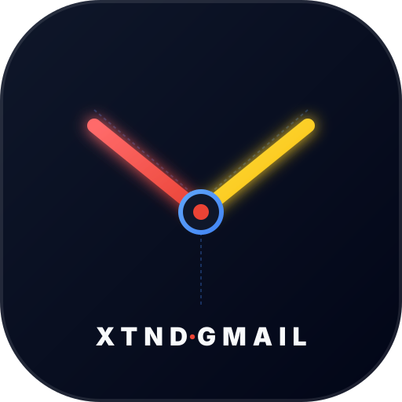

<div align="center">



# XTND | MCP | GMAIL

**Supreme MCP Server for Gmail & Google Workspace with Dual-Mode App Password & OAuth2 Support.**

[](https://www.npmjs.com/package/@xtnd-dynamics/mcp-gmail)
[](LICENSE)
[](https://smithery.ai/servers/xtnd/mcp-gmail)

</div>

`@xtnd-dynamics/mcp-gmail` connects AI agents (Claude Desktop, Cursor, Codex, ChatGPT) to Gmail & Google Workspace. It provides search, thread inspection, markdown parsing, drafts, label management, and outbound email via both **Google App Passwords** (instant setup) and **Google Cloud OAuth2** (enterprise SSO).

---

## 🚀 Quick Start (Choose Your Mode)

### Mode 1: Google App Password Mode (Recommended & Instant)
No Google Cloud Console or OAuth client creation required.

1. Enable 2-Step Verification at [myaccount.google.com/signinoptions/two-step-verification](https://myaccount.google.com/signinoptions/two-step-verification).
2. Generate an App Password at [myaccount.google.com/apppasswords](https://myaccount.google.com/apppasswords).
3. Add to `claude_desktop_config.json`:

```json
{
  "mcpServers": {
    "GMAIL": {
      "command": "npx",
      "args": ["-y", "@xtnd-dynamics/mcp-gmail"],
      "env": {
        "GMAIL_EMAIL": "your-email@gmail.com",
        "GMAIL_APP_PASSWORD": "your-16-char-password"
      }
    }
  }
}
```

---

### Mode 2: Google Cloud OAuth 2.0 Mode (Granular Scopes)
1. Create a Desktop OAuth Client ID in [Google Cloud Console](https://console.cloud.google.com/apis/credentials).
2. Run setup in terminal:
```bash
npx -y @xtnd-dynamics/mcp-gmail setup --profile work
```
3. Add to `claude_desktop_config.json`:
```json
{
  "mcpServers": {
    "GMAIL": {
      "command": "npx",
      "args": ["-y", "@xtnd-dynamics/mcp-gmail"],
      "env": {
        "MCP_GMAIL_PROFILE": "work"
      }
    }
  }
}
```

---

## 🛠️ Complete Tool Suite

| Category | Tools |
|---|---|
| **Reading & Search** | `search_emails`, `get_recent_emails`, `get_email`, `get_thread` |
| **Outbound Email** | `send_email`, `reply_email`, `forward_email`, `create_draft` |
| **Organization & Labels** | `list_labels`, `create_label`, `delete_label` |
| **Triage & Cleanup** | `trash_email`, `mark_email_read` |

---

## ☁️ Hosted Cloudflare Worker Endpoint

`xtnd-mcp-gmail` is deployable as a global Streamable HTTP MCP Worker:
* **Endpoint:** `https://gmail.mcp.xgi.io/mcp`
* **Discovery Card:** `https://gmail.mcp.xgi.io/.well-known/mcp/server-card.json`
* **OpenAPI 3.1:** `https://gmail.mcp.xgi.io/openapi.json`
* **Health Probe:** `https://gmail.mcp.xgi.io/health`

---

## 📜 License
MIT © [XTND Dynamics](https://github.com/XTND-DYNAMICS)
